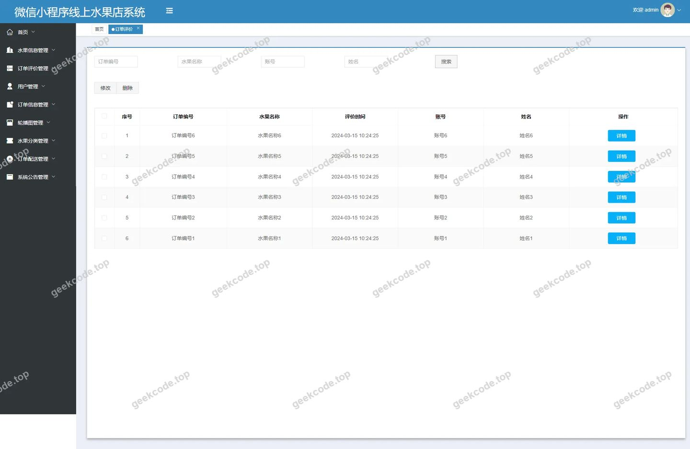
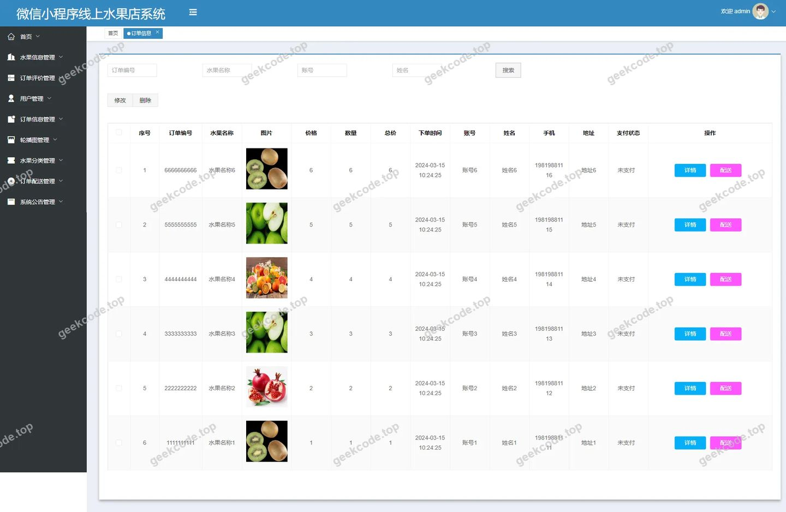
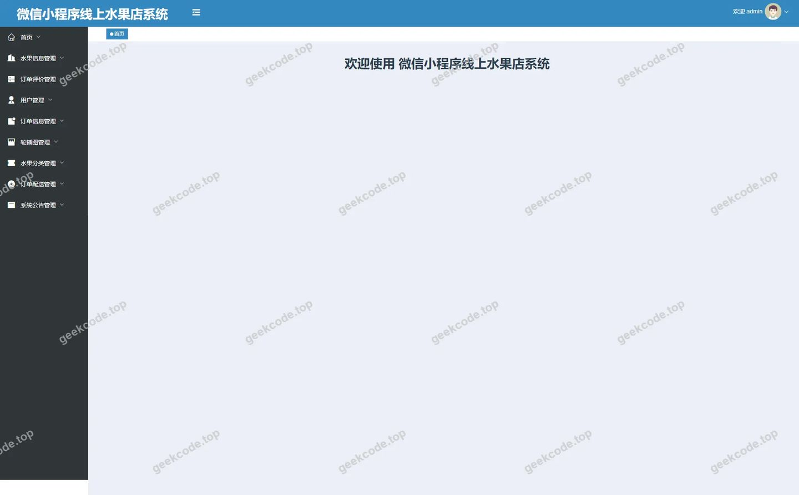
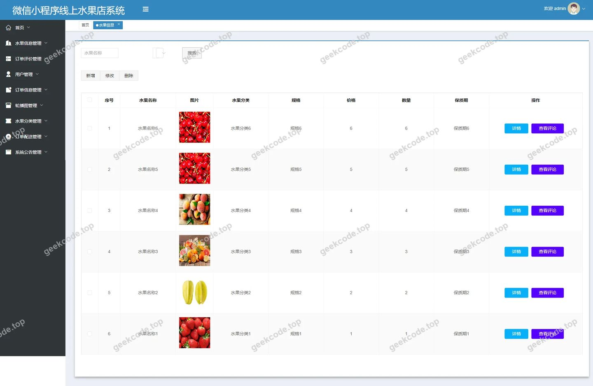
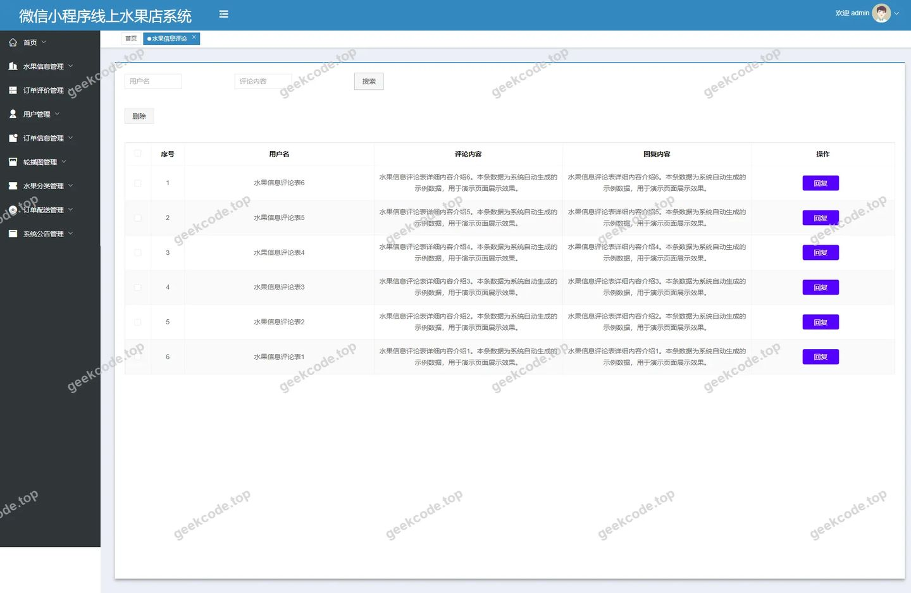
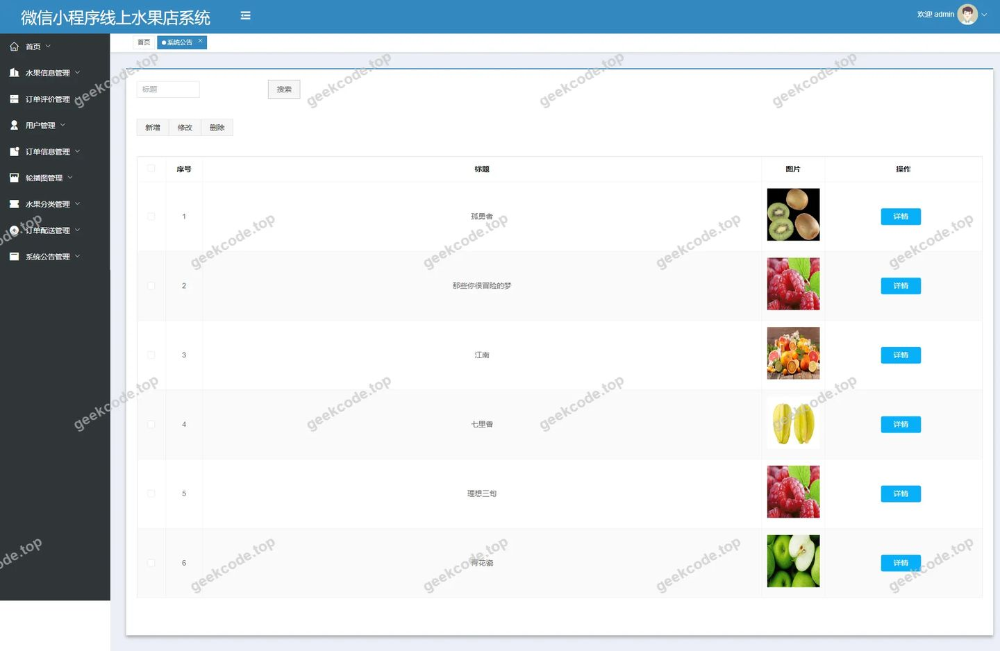
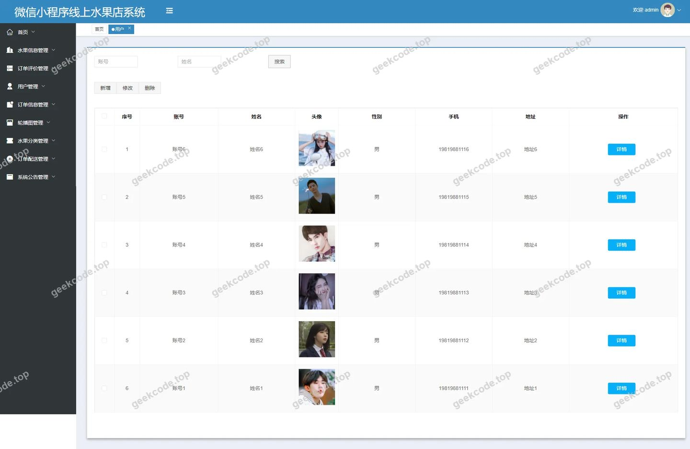

# [springboot]微信小程序线上水果店系统

> 🎓 **计算机毕业设计 · [springboot]微信小程序线上水果店系统**
>
> 本仓库只放**项目介绍 + 运行截图**（截图是站点带水印的原图，存在仓库 `images/` 里）。
>
> 👉 **完整可运行源码 / 数据库脚本 / 部署文档：[点我获取](https://geekcode.top/archives/springboot-%E5%BE%AE%E4%BF%A1%E5%B0%8F%E7%A8%8B%E5%BA%8F%E7%BA%BF%E4%B8%8A%E6%B0%B4%E6%9E%9C%E5%BA%97%E7%B3%BB%E7%BB%9F?utm_source=github)**
>
> 💬 咨询微信：**ir9372**　|　🌐 更多项目：[极客代码 geekcode.top](https://geekcode.top/?utm_source=github)
>
> 📌 项目详情页：<https://geekcode.top/archives/springboot-%E5%BE%AE%E4%BF%A1%E5%B0%8F%E7%A8%8B%E5%BA%8F%E7%BA%BF%E4%B8%8A%E6%B0%B4%E6%9E%9C%E5%BA%97%E7%B3%BB%E7%BB%9F?utm_source=github>

<table><td width="230" align="center"> <b>扫码加微信 ir9372</b></td><td valign="middle">📦 源码 = 项目介绍 + 全部运行截图 + 数据库 + 部署文档 👉 点上方任意截图，直接跳到 <b>极客代码 geekcode.top</b> 详情页</td></table>

---

<h1>[springboot]微信小程序线上水果店系统</h1>
<h2>项目概述</h2>

本项目为微信小程序线上水果店系统，旨在构建一个基于移动互联网的生鲜水果垂直电商平台。系统采用前后端分离架构，后端基于 Spring Boot 框架开发，前端适配微信小程序环境，实现了从商品展示、在线下单到订单配送的全流程闭环管理。核心功能涵盖水果信息管理、用户注册登录、订单处理、评价反馈及后台数据维护。适用人群包括水果零售商、消费者及平台管理员。技术架构上，后端利用 MyBatis-Plus 提升数据访问效率，通过 Shiro 实现安全权限控制，数据库选用 MySQL 存储业务数据。该系统有效解决了传统线下水果销售信息不对称、库存管理困难及用户触达率低的问题，提升了零售运营效率与用户体验。

<h2>技术架构</h2>

本系统采用经典的 B/S 架构结合移动端小程序形态，具体技术选型如下：

<strong>1. 后端架构</strong>

<ul>
<li><strong>核心框架</strong>：Spring Boot。利用其自动配置和起步依赖特性，快速搭建 RESTful API 服务，简化了 Web 层开发流程。</li>
<li><strong>持久层框架</strong>：MyBatis-Plus。在 MyBatis 基础上增强 CRUD 操作能力，支持 Lambda 表达式查询，显著减少了 SQL 映射文件的编写工作量，提高了代码的可读性与维护性。</li>
<li><strong>安全框架</strong>：Apache Shiro。负责系统的身份认证（Authentication）和授权（Authorization），确保只有经过验证的用户才能访问特定资源，保障数据安全。</li>
<li><strong>数据库连接</strong>：MySQL Connector Java。提供稳定的 JDBC 驱动支持。</li>
<li><strong>工具类库</strong>：Commons Lang3 用于字符串与对象处理，Validation-API 用于参数校验，Protobuf 用于高效的数据序列化传输。</li>
</ul>

<strong>2. 前端架构</strong>

<ul>
<li><strong>交互载体</strong>：微信小程序。依托微信生态庞大的用户基数，无需下载安装即可使用，具备轻量级、易传播的特点。</li>
<li><strong>集成模式</strong>：Vue-integrated 模式表明前端逻辑可能涉及 Vue.js 语法或组件化思维进行页面渲染与状态管理，通过 HTTP 请求与后端 Spring Boot 接口进行数据交互。</li>
</ul>

<strong>3. 数据库设计要点</strong>

<ul>
<li>数据库主要围绕“人、货、场”三个维度设计。包含用户表（存储账号信息与角色）、水果分类表、水果信息表（存储商品详情、价格、库存）、订单表（记录交易流水、状态）、订单评价表及系统公告表。各表之间通过外键关联，保证数据的一致性。</li>
</ul>
<h2>功能模块</h2>

根据后台路由配置及截图所示功能，系统主要划分为以下模块：

<h3>后台管理端功能</h3>
<ol>
<li><strong>系统公告管理 (/news)</strong></li>
</ol>
<ul>
<li>发布、编辑、删除平台通知或促销信息。</li>
<li>支持富文本或简单文本内容录入，用于向所有用户广播重要消息。</li>
</ul>
<ol start="2">
<li><strong>用户管理 (/yonghu)</strong></li>
</ol>
<ul>
<li>查看注册用户列表，包括昵称、手机号、注册时间等基本信息。</li>
<li>支持对用户状态的管控，如禁用违规账号或重置密码。</li>
</ul>
<ol start="3">
<li><strong>水果分类管理 (/shuiguofenlei)</strong></li>
</ol>
<ul>
<li>定义和维护水果的类别体系（如热带水果、浆果类、柑橘类等）。</li>
<li>支持增删改查分类名称及排序权重，便于前台商品归类展示。</li>
</ul>
<ol start="4">
<li><strong>水果信息管理 (/shuiguoxinxi)</strong></li>
</ol>
<ul>
<li>上架新水果商品，录入名称、所属分类、单价、库存、图片及详细描述。</li>
<li>修改现有商品信息，下架售罄或过期商品。</li>
<li>支持按分类或关键词检索商品，方便管理员快速定位。</li>
</ul>
<ol start="5">
<li><strong>订单信息管理 (/dingdanxinxi)</strong></li>
</ol>
<ul>
<li>查看所有历史订单及当前待处理订单。</li>
<li>监控订单状态流转（如待支付、已支付、待发货、已完成）。</li>
<li>支持手动干预异常订单，如取消订单或标记退款。</li>
</ul>
<ol start="6">
<li><strong>订单配送管理 (/dingdanpeisong)</strong></li>
</ol>
<ul>
<li>针对已支付订单进行物流安排。</li>
<li>更新配送员信息、配送状态及预计送达时间。</li>
<li>确认收货操作，完成订单闭环。</li>
</ul>
<ol start="7">
<li><strong>订单评价管理 (/dingdanpingjia)</strong></li>
</ol>
<ul>
<li>查看用户对已完成订单的综合评分与文字评价。</li>
<li>审核评价内容，过滤恶意差评或违规言论。</li>
<li>统计好评率，作为服务质量考核依据。</li>
</ul>
<ol start="8">
<li><strong>水果信息评论管理 (/discussshuiguoxinxi)</strong></li>
</ol>
<ul>
<li>管理用户在商品详情页发起的咨询或讨论。</li>
<li>回复用户疑问，维护社区氛围。</li>
<li>删除不当评论，保持评论区整洁。</li>
</ul>
<ol start="9">
<li><strong>收藏管理 (/storeup)</strong></li>
</ol>
<ul>
<li>查看用户的收藏记录，分析热门商品趋势。</li>
<li>虽通常由用户自主操作，但后台可查看数据以辅助营销决策。</li>
</ul>
<ol start="10">
<li><strong>系统配置 (/config)</strong></li>
</ol>
<ul>
<li>管理平台基础参数，如网站标题、Logo、联系电话、默认头像等全局设置。</li>
</ul>
<h3>前台用户端功能</h3>

<em>注：根据提供的上下文，“无前台导航菜单”且未列出具体前台路由，但基于“微信小程序线上水果店系统”的项目定义及后台对应的数据实体，可推断前台具备以下基础交互能力：</em>

<ol>
<li><strong>首页浏览</strong>：展示轮播图、推荐水果及最新公告。</li>
<li><strong>商品检索</strong>：通过分类树或搜索框查找特定水果。</li>
<li><strong>商品详情</strong>：查看水果图片、价格、剩余库存及历史评论。</li>
<li><strong>购物车/下单</strong>：选择规格数量，提交订单并模拟支付流程。</li>
<li><strong>个人中心</strong>：查看我的订单、修改个人信息、管理收藏。</li>
</ol>
<h2>用户角色与权限</h2>

系统主要涉及两类角色，其权限边界清晰划分：

<table>
<thead>
<tr>
<th align="left">角色</th>
<th align="left">权限描述</th>
<th align="left">可访问功能模块</th>
</tr>
</thead>
<tbody><tr>
<td align="left"><strong>管理员 (Admin)</strong></td>
<td align="left">拥有系统最高权限，负责整体运营监控、数据维护及安全配置。需通过 Shiro 认证登录后进入后台。</td>
<td align="left">1. <strong>全部后台路由</strong>：- <code>/news</code> (公告)- <code>/yonghu</code> (用户)- <code>/shuiguofenlei</code> (分类)- <code>/shuiguoxinxi</code> (商品)- <code>/dingdanxinxi</code> (订单)- <code>/dingdanpeisong</code> (配送)- <code>/dingdanpingjia</code> (订单评价)- <code>/discussshuiguoxinxi</code> (商品评论)- <code>/storeup</code> (收藏数据)- <code>/config</code> (系统配置)2. <strong>系统登录页</strong>：仅限管理员账户访问。</td>
</tr>
<tr>
<td align="left"><strong>普通用户 (User)</strong></td>
<td align="left">消费者角色，权限仅限于个人数据的读写及公共信息的浏览。无法访问任何后台管理界面。</td>
<td align="left">1. <strong>前台浏览</strong>：- 查看首页、公告、商品列表。2. <strong>个人操作</strong>：- 注册/登录。- 浏览商品详情。- 创建订单、支付。- 发表商品评论、订单评价。- 收藏商品。- 查看自己的订单状态与配送进度。- 修改个人资料。</td>
</tr>
</tbody></table>
<h2>项目特色与创新点</h2>
<ol>
<li>
<strong>轻量化移动电商体验</strong>
   基于微信小程序生态，用户无需安装独立 APP，降低了获客门槛和使用成本。结合 Spring Boot 的高并发处理能力，能够支撑校园或社区场景下的即时购物需求。

</li>
<li>
<strong>精细化运营管理体系</strong>
   区别于简单的买卖系统，本项目将“订单评价”与“商品评论”分离管理（<code>/dingdanpingjia</code> vs <code>/discussshuiguoxinxi</code>）。前者关注交易履约质量，后者关注商品本身属性，有助于商家多维度收集反馈，优化选品与服务。同时引入独立的“订单配送”模块，强化了物流环节的可视化与控制力。

</li>
<li>
<strong>安全可靠的权限控制</strong>
   集成 Apache Shiro 框架，实现了细粒度的访问控制。不仅保护了后台管理接口不被非法调用，还确保了用户隐私数据（如手机号、地址）仅在授权范围内可见，符合信息安全规范。

</li>
<li>
<strong>高效的数据持久层设计</strong>
   采用 MyBatis-Plus 替代原生 MyBatis，通过通用 Mapper 和条件构造器，大幅减少了重复的代码生成工作。在处理复杂的水果筛选查询（多条件组合）时，展现了极高的开发效率和运行性能。

</li>
</ol>
<h2>部署环境</h2>

为确保系统正常运行，需准备以下软硬件环境：

<strong>1. 硬件要求</strong>

<ul>
<li>CPU：双核及以上</li>
<li>内存：4GB RAM 及以上（建议 8GB 以应对 Java 虚拟机开销）</li>
<li>硬盘：至少 20GB 可用空间</li>
</ul>

<strong>2. 软件环境</strong>

<ul>
<li><strong>操作系统</strong>：Windows 10/11, Linux (CentOS 7+/Ubuntu 20.04+) 或 macOS。</li>
<li><strong>JDK</strong>：Java Development Kit 1.8 或更高版本（推荐 JDK 1.8，兼容性好）。</li>
<li><strong>数据库</strong>：MySQL 5.7 或 MySQL 8.0。需初始化相关表结构及基础数据。</li>
<li><strong>Web 服务器</strong>：内置 Tomcat（由 Spring Boot Starter Web 提供），无需单独安装外部 Tomcat。</li>
<li><strong>开发工具</strong>：</li>
<li>IntelliJ IDEA 或 Eclipse（用于后端开发与编译）。</li>
<li>Node.js（若前端工程化需要构建脚本）。</li>
<li><strong>微信开发者工具</strong>：用于调试微信小程序前端代码，预览真机效果。</li>
<li><strong>其他依赖</strong>：Maven（用于管理 Java 依赖包，如 mybatis-plus, shiro-spring 等）。</li>
</ul>

<strong>3. 网络环境</strong>

<ul>
<li>服务器需开放 8080（或其他配置的端口）供小程序后端接口调用。</li>
<li>小程序端需配置合法的 HTTPS 域名白名单（生产环境要求）。</li>
</ul>
<h2>五、技术特性</h2>
<ul>
<li>前后端集成部署，前端资源打包至后端 static 目录</li>
<li>使用 MyBatis-Plus 简化数据访问层开发</li>
<li>集成 Shiro 权限框架实现角色权限控制</li>
</ul>
<h2>六、功能模块截图</h2>
<h3>后台管理端</h3>
<h4>后台-登录页</h4>

<h4>后台-订单评价</h4>

<h4>后台-订单信息</h4>

<h4>页面-首页</h4>

<h4>后台-水果信息</h4>

<h4>后台-水果信息评论</h4>

<h4>后台-系统公告</h4>

<h4>后台-用户</h4>

---

## 获取完整源码

| 项目 | 说明 |
| --- | --- |
| 项目名 | [springboot]微信小程序线上水果店系统 |
| 运行截图 | 本文 8 张（站点带水印原图，仓库 `images/` 目录） |
| 完整源码 | [https://geekcode.top/archives/springboot-%E5%BE%AE%E4%BF%A1%E5%B0%8F%E7%A8%8B%E5%BA%8F%E7%BA%BF%E4%B8%8A%E6%B0%B4%E6%9E%9C%E5%BA%97%E7%B3%BB%E7%BB%9F?utm_source=github](https://geekcode.top/archives/springboot-%E5%BE%AE%E4%BF%A1%E5%B0%8F%E7%A8%8B%E5%BA%8F%E7%BA%BF%E4%B8%8A%E6%B0%B4%E6%9E%9C%E5%BA%97%E7%B3%BB%E7%BB%9F?utm_source=github) |
| 咨询微信 | **ir9372**（备注：jingpin-yuanma） |
| 更多项目 | [极客代码 geekcode.top](https://geekcode.top/?utm_source=github) |

> 需要源码、部署、改配置、跑不起来等问题，加微信 ir9372 沟通，说明项目名即可。
